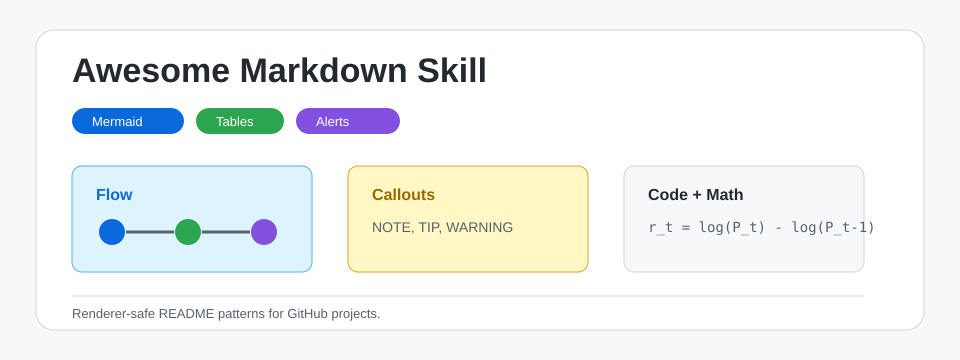
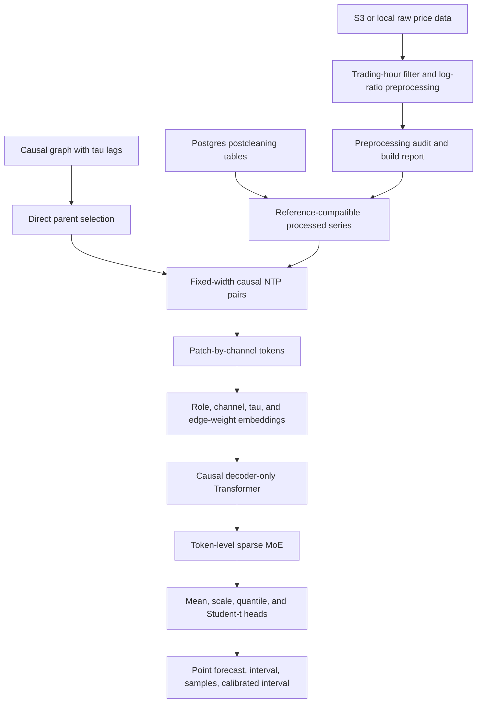
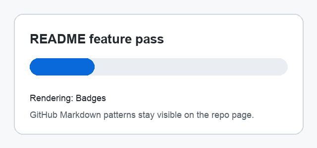

# Awesome Markdown Skill

<p align="center">
  
  
  
  
</p>

<p align="center">
  
</p>

`awesome-markdown` is a Codex skill for creating GitHub README files that are visually rich, renderer-safe, and easy to scan. This README is also a live showcase of the Markdown patterns the skill teaches.

> [!NOTE]
> The skill itself stays compact. Detailed patterns are loaded only when needed from `awesome-markdown/references/`.

> [!TIP]
> Use this repository as a starter when you want a README that demonstrates GitHub Markdown features directly on the repo front page.

> [!WARNING]
> GitHub README files do not run custom JavaScript, iframes, or external CSS. Use GitHub Pages or a docs framework for real interactivity.

## Skill Layout

| Path | Purpose |
|---|---|
| `awesome-markdown/SKILL.md` | Core trigger metadata and workflow |
| `awesome-markdown/references/github-readme-patterns.md` | On-demand snippets for rich GitHub Markdown |
| `awesome-markdown/references/review-checklist.md` | Final audit checklist |
| `awesome-markdown/assets/` | Small local media assets used by examples |

## Mermaid Flowchart



## Collapsible Details

<details>
<summary>Show example README configuration</summary>

```yaml
renderer: github
sections:
  - badges
  - alerts
  - mermaid
  - tables
  - details
  - media
  - math
  - task_lists
compatibility:
  allow_html: limited
  allow_javascript: false
```

</details>

## Code Blocks

```bash
python train.py --config configs/forecast.yaml
```

```python
from pathlib import Path

readme = Path("README.md").read_text()
assert "`" * 3 + "mermaid" in readme
```

```sql
select symbol, avg(return_1m) as mean_return
from price_features
group by symbol;
```

## Math

Inline math works for compact notation such as $r_t$. Display math is useful for core formulas:

$$
r_t = \log(P_t) - \log(P_{t-1})
$$

$$
\hat{y}_{t+h} = \mu_\theta(x_{\le t}, h)
$$

## Media

SVG is useful for crisp architecture previews:

<p align="center">
  
</p>

GIF is useful for short visual demos:

<p align="center">
  
</p>

## Task List

- [x] Create the skill folder with `SKILL.md`
- [x] Move detailed examples into `references/`
- [x] Add local media assets
- [x] Demonstrate rich Markdown in the root README
- [ ] Push to `https://github.com/Minions-Land/Awesome-Markdown-Skill`

## GeoJSON Map

```geojson
{
  "type": "FeatureCollection",
  "features": [
    {
      "type": "Feature",
      "properties": {
        "name": "Shanghai"
      },
      "geometry": {
        "type": "Point",
        "coordinates": [121.4737, 31.2304]
      }
    }
  ]
}
```

## TopoJSON Map

```topojson
{
  "type": "Topology",
  "objects": {
    "example": {
      "type": "GeometryCollection",
      "geometries": [
        {
          "type": "Point",
          "properties": {
            "name": "Shanghai"
          },
          "coordinates": [121.4737, 31.2304]
        }
      ]
    }
  },
  "arcs": []
}
```

## STL Preview

```stl
solid triangle
  facet normal 0 0 1
    outer loop
      vertex 0 0 0
      vertex 1 0 0
      vertex 0 1 0
    endloop
  endfacet
endsolid triangle
```

## Lightweight HTML

Use small HTML helpers when standard Markdown is not enough:

Press <kbd>Ctrl</kbd> + <kbd>C</kbd> to stop a local server.

<p align="center">
  <strong>Centered text and sized images work in GitHub README files.</strong>
</p>

## When README Is Not Enough

| Need | Better Tool |
|---|---|
| Full documentation site | MkDocs, Docusaurus, or VitePress |
| Interactive demos | GitHub Pages or Storybook |
| Notebook-style narrative | Jupyter Book |
| API reference publishing | Docs framework plus generated API docs |

## Install Locally

Copy or symlink `awesome-markdown/` into your Codex skills directory:

```bash
mkdir -p "${CODEX_HOME:-$HOME/.codex}/skills"
ln -s "$(pwd)/awesome-markdown" "${CODEX_HOME:-$HOME/.codex}/skills/awesome-markdown"
```

Then invoke it with:

```text
Use $awesome-markdown to create a rich GitHub README for this repository.
```
