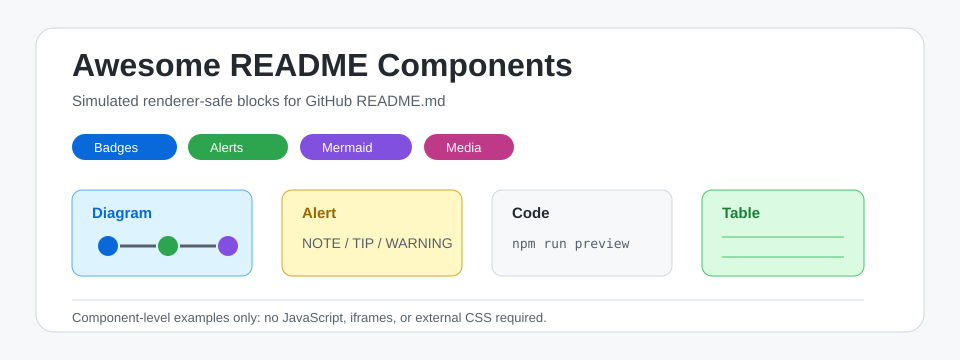
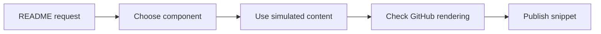
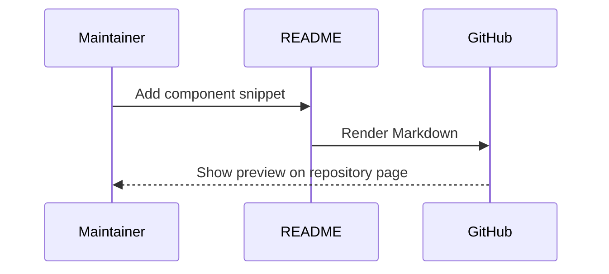
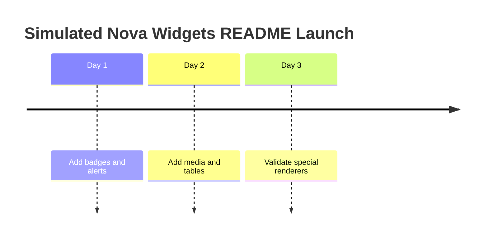
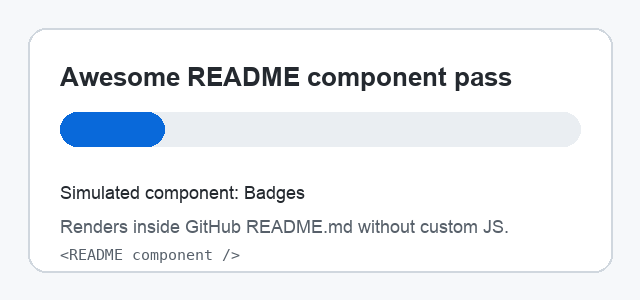

# Awesome README Skill

<p align="center">
  
  
  
  
  
  
</p>

<p align="center">
  
</p>

<p align="center">
  <a href="#badge-row">Badges</a> |
  <a href="#alerts">Alerts</a> |
  <a href="#mermaid">Mermaid</a> |
  <a href="#mdx-snippet">MDX</a> |
  <a href="#tables">Tables</a> |
  <a href="#media">Media</a> |
  <a href="#special-renderers">Special Renderers</a> |
  <a href="#install">Install</a>
</p>

`awesome-readme` is a Codex skill for building component-level GitHub README examples. It does not prescribe a full page layout; it collects renderer-safe components that can be copied into a README and adapted.

All examples in this repository are simulated. The sample product name used below, `Nova Widgets`, is fictional.

> [!NOTE]
> This repository focuses on components that render inside GitHub README.md.

> [!IMPORTANT]
> README files cannot depend on custom JavaScript, iframes, or external CSS.

> [!TIP]
> Use local images and GIFs for stable screenshots, diagrams, and demos.

> [!WARNING]
> Do not paste real secrets, private URLs, or unreleased metrics into public README examples.

> [!CAUTION]
> Destructive command examples should be visibly marked and kept out of quick-start snippets.

## Skill Package

| Path | Purpose |
|---|---|
| `awesome-readme/SKILL.md` | Compact skill instructions and trigger metadata |
| `awesome-readme/references/component-library.md` | Component snippets for GitHub README files |
| `awesome-readme/references/review-checklist.md` | Final compatibility and open-source checklist |
| `awesome-readme/references/research-readme-flow.md` | Whole-README flow for research code and tools: evidence first, section order, writing rules, checklist |
| `awesome-readme/assets/research-readme-template.md` | Skeleton for a whole README (results, architecture, data, quick start, layout) |
| `awesome-readme/assets/` | Local simulated media assets |
| `LICENSE` | MIT license |

## Badge Row

```md


```

Rendered example:


## Link Bar

```html
<p align="center">
  <a href="#quick-start">Quick Start</a> |
  <a href="#components">Components</a> |
  <a href="#examples">Examples</a> |
  <a href="#license">License</a>
</p>
```

## Alerts

```md
> [!NOTE]
> Nova Widgets uses simulated sample data.

> [!IMPORTANT]
> Keep renderer-safe components free of JavaScript.
```

## Mermaid

### Component Flow



### Sequence Diagram



### Timeline



## Tables

| Component | Renders In README | Best Use | Avoid |
|---|---:|---|---|
| Badge | Yes | Status and metadata | Too many colors |
| Alert | Yes | Important notes | Long paragraphs |
| Mermaid | Yes | Diagrams | Dense architecture maps |
| MDX snippet | Yes, as code | Docs-site examples | Claiming JSX executes |
| GIF | Yes | Short demos | Huge files |
| iframe | No | Use GitHub Pages | README embeds |

## HTML Image Grid

<table>
  <tr>
    <td align="center">
      <br>
      <strong>Component Cards</strong>
    </td>
    <td align="center">
      <br>
      <strong>Animated Demo</strong>
    </td>
    <td align="center">
      <br>
      <strong>Media Preview</strong>
    </td>
  </tr>
</table>

## Collapsible Details

<details>
<summary>Show simulated component configuration</summary>

```yaml
project: nova-widgets
mode: component-gallery
renderer: github-readme
components:
  - badges
  - alerts
  - mermaid
  - tables
  - media
```

</details>

## Code Blocks

```bash
npm create nova-widget@latest
```

```json
{
  "name": "nova-widgets-demo",
  "private": true,
  "readmeComponents": ["badges", "alerts", "mermaid", "mdx-snippet"]
}
```

```diff
+ add renderer-safe README component
- remove unsupported iframe example
```

## MDX Snippet

MDX is useful to document how a component would be written in a docs site. In GitHub README.md, keep it as a fenced code example; the JSX does not execute on the repository page.

```mdx
import { DemoCard } from './components/DemoCard'

# Nova Widgets

<DemoCard tone="info" title="Simulated MDX Card">
  This card is an MDX authoring example, not an active README widget.
</DemoCard>

export const metadata = {
  status: 'simulated',
  renderer: 'docs-site'
}
```

## Math

Inline math works for compact notation such as $score = clicks / views$.

$$
quality = 0.5 \cdot clarity + 0.3 \cdot completeness + 0.2 \cdot visual\_fit
$$

## Media

SVG is useful for crisp local README visuals:

<p align="center">
  
</p>

GIF is useful for short demos:

<p align="center">
  
</p>

## Task List

- [x] Rename the skill to `awesome-readme`
- [x] Replace copied examples with simulated examples
- [x] Add MIT license
- [x] Expand README components
- [x] Keep the repository component-level

## Keyboard Tags

Press <kbd>Cmd</kbd> + <kbd>K</kbd> to open the simulated command palette.

Press <kbd>Ctrl</kbd> + <kbd>C</kbd> to stop a local demo server.

## Footnotes

Footnotes are useful for short caveats without interrupting the component.[^simulated]

[^simulated]: `Nova Widgets` is a fictional project used only for README examples.

## GitHub Metadata Links

GitHub automatically links many repository references, including issues like `#12`, users like `@demo-maintainer`, and commit SHAs when they exist in the same repository context.

## Special Renderers

### GeoJSON

```geojson
{
  "type": "Feature",
  "properties": {
    "name": "Simulated Demo Point"
  },
  "geometry": {
    "type": "Point",
    "coordinates": [12.3456, 45.6789]
  }
}
```

### TopoJSON

```topojson
{
  "type": "Topology",
  "objects": {
    "demo": {
      "type": "GeometryCollection",
      "geometries": [
        {
          "type": "Point",
          "properties": {
            "name": "Simulated Node"
          },
          "coordinates": [12.3456, 45.6789]
        }
      ]
    }
  },
  "arcs": []
}
```

### STL

```stl
solid demo_pyramid
  facet normal 0 0 1
    outer loop
      vertex 0 0 0
      vertex 1 0 0
      vertex 0.5 0.8 0
    endloop
  endfacet
endsolid demo_pyramid
```

## What This Skill Does Not Provide

| Not A README Component | Better Place |
|---|---|
| Live JavaScript charts | GitHub Pages |
| iframe demos | Storybook or docs site |
| Executable MDX components | Docusaurus, Next.js, Storybook, or another MDX pipeline |
| Custom CSS layouts | MkDocs, Docusaurus, or VitePress |
| Full navigation systems | Documentation framework |

## Install

Copy or symlink `awesome-readme/` into your Codex skills directory:

```bash
mkdir -p "${CODEX_HOME:-$HOME/.codex}/skills"
ln -s "$(pwd)/awesome-readme" "${CODEX_HOME:-$HOME/.codex}/skills/awesome-readme"
```

Then invoke it with:

```text
Use $awesome-readme to create a GitHub README component gallery.
```
