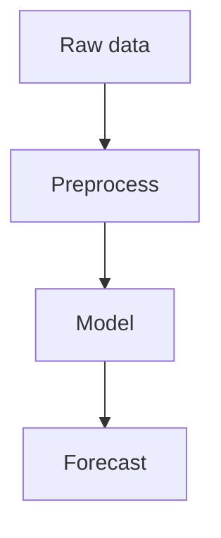

# GitHub README Patterns

Use these patterns when a user asks for a README that looks rich on GitHub while staying portable and maintainable.

## Badges

Use badges for compact status and metadata. Put only high-signal badges near the top.

```md


```

## Alerts

Use GitHub alert blocks for important notes, tips, warnings, and constraints.

```md
> [!NOTE]
> This project targets GitHub-flavored Markdown.

> [!WARNING]
> GitHub README files do not run custom JavaScript or iframes.
```

## Mermaid

Use Mermaid for architecture, dependency, state, sequence, and workflow diagrams.

````md

````

## Tables

Use tables for feature matrices, schema summaries, benchmark comparisons, and option tradeoffs.

```md
| Pattern | Best For | Notes |
|---|---|---|
| Mermaid | Pipelines and graphs | Renders on GitHub |
| Alerts | Important callouts | Keep short |
| Details | Long optional sections | Do not hide quick start |
```

## Collapsible Details

Use collapsible details for logs, full configs, model cards, or secondary examples.

````md
<details>
<summary>Show training config</summary>

```yaml
batch_size: 64
learning_rate: 0.0003
model: decoder-only-transformer
```

</details>
````

## Media

Use repository-local media for screenshots and demos. Prefer PNG/JPG for screenshots, SVG for diagrams, and GIF for short demos.

```md


```

Use HTML when the README needs image sizing or centering.

```html
<p align="center">
  
</p>
```

## Code Blocks

Always label fenced code blocks with a language.

````md
```bash
python train.py --config configs/base.yaml
```

```python
forecast = model.predict(series)
```
````

## Math

Use display math for core equations and inline math for short terms.

```md
The log return is $r_t$.

$$
r_t = \log(P_t) - \log(P_{t-1})
$$
```

## Task Lists

Use task lists for roadmap, migration status, launch readiness, or paper checklist sections.

```md
- [x] Preprocessing pipeline
- [x] Mermaid architecture diagram
- [ ] Online inference example
```

## GeoJSON, TopoJSON, and STL

Use these code blocks only when the rendered map or 3D preview directly helps the reader.

````md
```geojson
{
  "type": "Point",
  "coordinates": [121.4737, 31.2304]
}
```

```stl
solid triangle
  facet normal 0 0 1
    outer loop
      vertex 0 0 0
      vertex 1 0 0
      vertex 0 1 0
    endloop
  endfacet
endsolid triangle
```
````

## Lightweight HTML

Use only renderer-safe HTML for layout polish.

```md
Press <kbd>Ctrl</kbd> + <kbd>C</kbd> to stop the server.

<p align="center">
  
</p>
```

## Unsupported in GitHub README

Avoid these in normal GitHub README files:

- Custom JavaScript
- `<script>` tags
- `<iframe>` embeds
- External CSS
- Runtime widgets that require browser execution

Use GitHub Pages, MkDocs, Docusaurus, VitePress, Storybook, or Jupyter Book when the documentation needs real interactivity.
