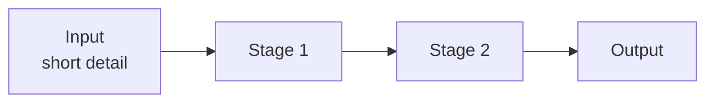

# PROJECT_NAME

<p align="center">
  <strong>ONE_LINE_TAGLINE — what it is and what it is for, in plain words.</strong>
</p>

<p align="center">
  <a href="#results">Results</a> ·
  <a href="#architecture">Architecture</a> ·
  <a href="#data">Data</a> ·
  <a href="#quick-start">Quick start</a> ·
  <a href="#repository-layout">Layout</a>
</p>

**Language:** English · [简体中文](README_zh-CN.md)


ONE_PARAGRAPH_OVERVIEW: the idea, the input, the output, and the one design choice that matters.

| Component / objective | What it does | Why |
|---|---|---|
| ... | ... | ... |

> [!NOTE]
> ONE_FACT_THE_READER_MUST_NOT_MISS (e.g. paths point at an internal server).

## Results

SETTING: dataset, split, training budget, hardware — so the numbers can be compared.

| Method | METRIC_1 | METRIC_2 | METRIC_3 |
|---|---:|---:|---:|
| **This project** | **0.000** | **0.000** | 0.000 |
| Baseline A | 0.000 | 0.000 | **0.000** |
| Baseline B | 0.000 | 0.000 | 0.000 |

- What the table shows, in one or two bullets.
- What is still weak, and what is being done about it.

## Architecture



| Component | Setting |
|---|---|
| ... | ... |

## Data

| Set | Size | What it is |
|---|---:|---|
| ... | ... | ... |

## Quick start

OS · Python · GPU · package manager.

```bash
COMMAND_1   # what it does
COMMAND_2   # what it does
```

## Repository layout

```
package/
  module.py     one-line purpose
scripts/        entry points
tests/          what the tests guarantee
```

## Acknowledgements

Built on [LIBRARY](https://...), ideas from PAPER. License: LICENSE.
