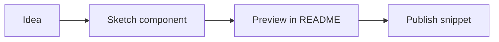
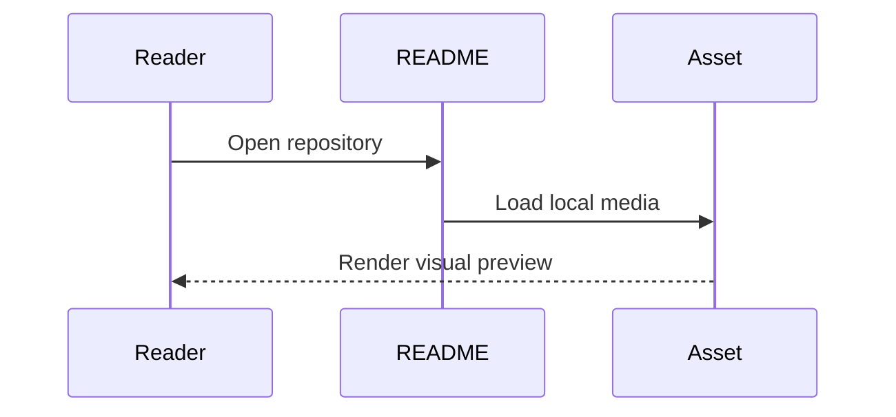
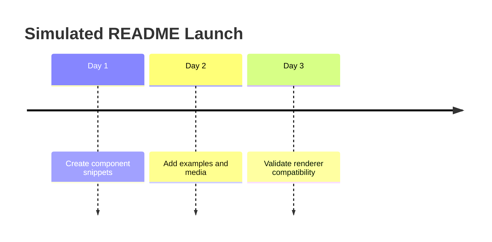

# GitHub README Component Library

Use these components as copy-pasteable building blocks for GitHub README files. Keep examples simulated unless the user supplies real project data.

## Badge Row

```md


```

## Centered Hero Asset

```html
<p align="center">
  
</p>
```

## Link Bar

```md
<p align="center">
  <a href="#quick-start">Quick Start</a> |
  <a href="#components">Components</a> |
  <a href="#examples">Examples</a> |
  <a href="#license">License</a>
</p>
```

## GitHub Alerts

```md
> [!NOTE]
> Use notes for context the reader should know before trying a component.

> [!TIP]
> Use tips for shortcuts or recommended defaults.

> [!IMPORTANT]
> Use important callouts for required constraints.

> [!WARNING]
> Use warnings for risks that can break a workflow.

> [!CAUTION]
> Use caution for destructive or irreversible operations.
```

## Mermaid Flowchart

````md

````

## Mermaid Sequence

````md

````

## Mermaid Timeline

````md

````

## Compact Feature Table

```md
| Component | Renders in README | Best Use |
|---|---:|---|
| Badge | Yes | Status and metadata |
| Alert | Yes | Important notes |
| Mermaid | Yes | Diagrams |
| iframe | No | Use GitHub Pages instead |
```

## Image Grid

```html
<table>
  <tr>
    <td align="center"><br><strong>Card A</strong></td>
    <td align="center"><br><strong>Card B</strong></td>
    <td align="center"><br><strong>Card C</strong></td>
  </tr>
</table>
```

## Logo Strip

```html
<p align="center">
  
  
  
</p>
```

## Collapsible Details

````md
<details>
<summary>Show simulated configuration</summary>

```yaml
theme: clean
components:
  - badges
  - alerts
  - diagrams
```

</details>
````

## Syntax Highlighting

````md
```bash
npm create nova-widget@latest
```

```diff
+ add README component gallery
- remove unsupported iframe embed
```

```json
{
  "name": "simulated-widget",
  "private": true
}
```
````

## MDX Snippet

Use MDX snippets when a README should teach how a docs-site component would be authored. In GitHub README.md, this renders as a code block; the JSX component is not executed.

````md
```mdx
import { DemoCard } from './components/DemoCard'

# Nova Widgets

<DemoCard tone="info" title="Simulated MDX Card">
  This card is an MDX authoring example, not an active README widget.
</DemoCard>

export const metadata = {
  status: 'simulated',
  renderer: 'docs-site'
}
```
````

## Math

```md
Inline math: $score = clicks / views$.

$$
quality = 0.5 \cdot clarity + 0.3 \cdot completeness + 0.2 \cdot visual\_fit
$$
```

## Task List

```md
- [x] Add badge row
- [x] Add Mermaid preview
- [ ] Replace simulated screenshots with product screenshots
```

## Keyboard Tags

```md
Press <kbd>Cmd</kbd> + <kbd>K</kbd> to open the simulated command menu.
```

## GitHub Metadata Links

```md
Related: #12, GH-42, @demo-maintainer, `docs/components.md`
```

## Footnotes

```md
Use footnotes for short source notes or caveats.[^demo]

[^demo]: This is simulated README content.
```

## Definition List Alternative

GitHub does not support every extended Markdown definition-list feature consistently. Use tables instead:

```md
| Term | Meaning |
|---|---|
| Component | A reusable README snippet |
| Renderer-safe | Displays directly on GitHub |
```

## GeoJSON

````md
```geojson
{
  "type": "Feature",
  "properties": { "name": "Simulated Demo Point" },
  "geometry": {
    "type": "Point",
    "coordinates": [12.3456, 45.6789]
  }
}
```
````

## TopoJSON

````md
```topojson
{
  "type": "Topology",
  "objects": {
    "demo": {
      "type": "GeometryCollection",
      "geometries": [
        {
          "type": "Point",
          "properties": { "name": "Simulated Node" },
          "coordinates": [12.3456, 45.6789]
        }
      ]
    }
  },
  "arcs": []
}
```
````

## ASCII STL

````md
```stl
solid demo_pyramid
  facet normal 0 0 1
    outer loop
      vertex 0 0 0
      vertex 1 0 0
      vertex 0.5 0.8 0
    endloop
  endfacet
endsolid demo_pyramid
```
````

## What Not To Use In README

- `<script>` tags
- iframes
- custom CSS files
- runtime charts that require JavaScript
- executable MDX/JSX components inside README.md
- private hotlinked images
- widgets that only render in a documentation site
